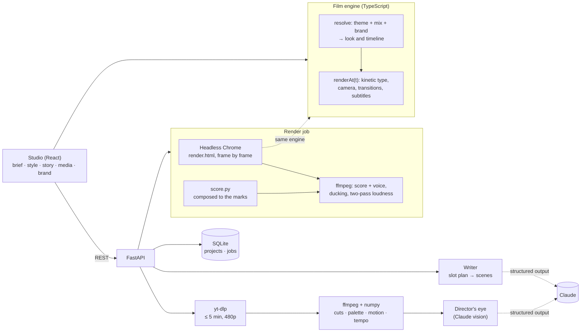

# Reel

**Product films, directed by AI.**

Reel makes short product films. Show it up to five videos whose look you love, and it measures each one: the cut rhythm, the palette, the motion, the tempo and the type. Then you mix and match, taking the pace from one film, the colour from another and the music from a blend of them all. Tell it what you need to say, with your key messages ranked and the hero message first. Pick a story shape like Three-act, Save the Cat or Problem, agitate, solve, and the director writes every scene to your length and pace. Add your screens, clips, logo and music, scrub the live preview, and render. The score is composed to the cut, builds to your hero message and drops on it.

https://github.com/user-attachments/assets/50f5d2b5-c88c-4850-8c2c-9c6373df8138

<sub>▶ The film, with sound (1 min 45 s), made in Reel. <a href="#the-film">How it was made</a>.</sub>

## What it shows

| | |
|---|---|
| **Style learnt from video** | Paste a link (or drop a file) up to 5 minutes long. Reel fetches a small copy with yt-dlp, measures it with ffmpeg and numpy, and deletes it. It keeps only the numbers and a contact sheet. Hard cuts come from ffmpeg's scene score; crossfades and camera moves come from comparing each frame with the one a second earlier |
| **A director's eye** | Claude looks at the contact sheet and the measurements and names the mood, the typography, the transitions, the camera and how text is used |
| **Mix and match** | Six traits (pace, palette, energy, music, type, motion), each taken from the theme, one reference, or a blend. The preview follows every click |
| **Story frameworks** | Three-act, Save the Cat, Problem, agitate, solve, Before, after, bridge, AIDA, the hero's journey, the story spine and a straight feature tour, as beats with a share of the running time |
| **A slot plan, not a free-for-all** | The framework's beats are split into scenes by the reel's length and the style's pace, each with a time and a word budget. Claude fills the slots with structured output; it never decides the timing, so a two-minute reel is two minutes |
| **Key messages that land** | Ranked messages, with the hero first. The hero lands at the story's peak, and the music drops on it. A coverage meter shows screen time per message and flags any that never land |
| **Direct the director** | Rewrite any scene: shorter, punchier, warmer, as a question, or your own note |
| **Your voice, if you want it** | A teleprompter records each line at the scene's pace. Silence is trimmed, the scene stretches to fit, and the music ducks under you |
| **One engine, preview and render** | The film is DOM, and every frame is a pure function of time. The studio scrubs it live; the renderer opens the same page in headless Chrome and screenshots it frame by frame |
| **Music cut to the beat** | An original score synthesised in Python, its style chosen by the mix's mood, at the references' tempo. Or upload a track: Reel finds its tempo and snaps every cut to the beat |
| **Brand** | A logo with colours taken from it, type, an intro sting, an end card, a corner bug and a watermark |
| **Any shape** | 16:9, 9:16, 1:1 and 4:5, at 15 seconds to 5 minutes, in a 720p draft or 1080p final |
| **Runs offline** | A deterministic scripted director fills the same slot plan from templates, so the whole product runs and tests with no API key |

## Architecture



A project is one JSON document. The engine resolves it into a look (the theme, overridden trait by trait by the references you mixed, then by your brand) and a timeline (scenes laid end to end, stretched to fit recorded lines, snapped to the beat, with the hero found and the music's marks placed). More detail is in [docs/architecture.md](docs/architecture.md).

## Run it

You need Python 3.12+ with [uv](https://docs.astral.sh/uv/), Node 22 with pnpm, ffmpeg, and Google Chrome.

**Locally, no API key needed.** This uses the scripted director:

```bash
cd frontend && pnpm install && pnpm build && cd ..   # the studio and the film engine
cd renderer && pnpm install && cd ..                 # the frame renderer and page capture
cd backend && uv sync
REEL_LLM=scripted uv run reel serve --port 8070      # the studio on http://127.0.0.1:8070
```

For live development of the studio, run `pnpm dev` in `frontend/` (on :5190, proxying the API).

**With Claude.** Copy `.env.example` to `.env` in `backend/` and set `ANTHROPIC_API_KEY`. Claude Opus 5.5 then reads each reference's look from its contact sheet and writes and rewrites the script with structured outputs and adaptive thinking.

**Measure a video from the command line:**

```bash
uv run reel style path/to/video.mp4    # prints its style DNA as JSON
```

Only use reference videos you have the right to watch. Reel measures them for style and deletes the download; it never puts their footage in your film.

## How it decides

**Pace.** A reference's average shot length sets the scene length: narrated scenes run about 1.8 times a reference's shot, between 3.2 and 8 seconds, so a fast-cut reference gives more, shorter scenes.

**Palette.** The measured colours are sorted by luminance and saturation. The stage comes from the darkest or lightest (by the reference's brightness), the accents from the most vivid, and any accent too close to the stage is lifted until it reads.

**Music.** The mix's mood words pick one of six score styles (Midnight, Study, Punch, Forge, Air, Arena), at the references' tempo. The score's sections follow the timeline: an intro under the hook, a groove, a hush and a riser before the hero message, the drop on it, and a final chord under the end card.

**The mix.** Voice clips sit at their scenes, the music side-chain ducks under them, and the mix is measured and normalised in two passes to -14 LUFS with the true peak under -1 dB.

## Tests

```bash
cd backend && uv run pytest -q    # style analysis on synthetic video, the slot plan, the API, the sound mix
cd frontend && pnpm test          # mixing, beat sync, hero detection, voice fitting, titles and stats
```

The style tests build videos with ffmpeg whose answers are known: five shots with cuts at 2, 4, 5 and 7 seconds and a click track at 120 bpm, and a one-second dissolve with no hard cut.

## Project layout

```
backend/reel/
  api.py            the studio's API, and background jobs for analysis, capture and render
  models.py         the project document
  director.py       the slot plan, Claude and the scripted director, prompts
  frameworks.py     story frameworks as beats, and tones
  style/fetch.py    yt-dlp, with the length limit enforced before and after download
  style/analyse.py  cuts, soft changes, palette, energy, tempo, loudness, contact sheet
  render.py         the render job: frames, score, voice, ducking, loudness
  score.py          the score synthesiser
frontend/src/
  film/             the engine: themes, resolve (look + timeline), engine (renderAt)
  studio/           the studio: brief, style, story, media, brand, render, player, teleprompter
  render.ts         the bare film page the renderer screenshots
renderer/           render.mjs (frames into ffmpeg) and capture.mjs (screens of a web page)
promo/              the film above, made in Reel
```

## The film

The film was made in Reel. `promo/record.mjs` runs the studio on the scripted director and uses it the way a person would: it writes a brief, learns the look of two films (the DebateDojo and Ashariri films from this Lab), mixes them, captures a web page, uploads a logo, writes and rewrites the script, previews and renders. It records a clip of each step. `promo/film.mjs` then makes a new reel in Reel from those clips. It learns the same two films, takes the pace, palette, energy and music from one and the motion from the other, sets a script edited by hand, and renders the final cut with its composed score.

```bash
cd promo && pnpm install
node record.mjs --app http://127.0.0.1:8070 --films http://127.0.0.1:8099   # clips of the studio in use
node film.mjs --data <REEL_DATA_DIR>                                          # the film, in promo/out/
```

---

Part of [the Lab](https://balajisriraj.com/#lab), agentic products by [Balaji Sri Raj](https://balajisriraj.com).
